# THE CODEFATHER — Database ERD & Platform Documentation

## 1. Entity Relationship Diagram (ERD)

```mermaid
erDiagram
    admins ||--o{ admin_sessions : "has active"
    admins ||--o{ admin_recovery_codes : "owns single-use"
    admins ||--o{ activity_logs : "performs"
    skill_categories ||--o{ skills : "contains"
    projects ||--o{ media_assets : "references"
    education_events ||--o{ media_assets : "references"

    admins {
        char(36) id PK
        varchar username UK
        varchar email UK
        varchar password_hash
        enum role
        varchar totp_secret
        boolean totp_enabled
        timestamp last_login_at
        timestamp created_at
    }

    admin_sessions {
        char(36) id PK
        char(36) admin_id FK
        char(64) token_hash UK
        char(64) csrf_token
        varchar ip_address
        timestamp expires_at
    }

    admin_recovery_codes {
        char(36) id PK
        char(36) admin_id FK
        varchar code_hash
        timestamp used_at
    }

    site_profile {
        int id PK
        varchar name_ar
        varchar name_en
        varchar role_ar
        varchar role_en
        text intro_ar
        text intro_en
        json about_ar_json
        json about_en_json
        varchar email
    }

    skill_categories {
        char(36) id PK
        varchar name_ar
        varchar name_en
        int sort_order
    }

    skills {
        char(36) id PK
        char(36) category_id FK
        varchar name
        varchar code
        tinyint level
        varchar desc_ar
        varchar desc_en
    }

    projects {
        varchar id PK
        varchar code
        varchar title_ar
        varchar title_en
        text short_ar
        text short_en
        mediumtext full_ar
        mediumtext full_en
        varchar category_ar
        varchar category_en
        json technologies_json
        smallint year
        varchar image_url
        enum status
        boolean featured
        timestamp published_at
    }

    education_events {
        char(36) id PK
        smallint year
        int sort_order
        varchar title_ar
        varchar title_en
        text desc_ar
        text desc_en
        varchar image_url
        enum status
    }

    contact_messages {
        char(36) id PK
        varchar name
        varchar email
        varchar subject
        text message
        enum status
        varchar ip_address
        timestamp created_at
    }

    media_assets {
        char(36) id PK
        varchar filename UK
        varchar mime_type
        int size_bytes
        varchar url
    }

    site_settings {
        varchar setting_key PK
        mediumtext setting_value
    }

    notifications {
        char(36) id PK
        enum type
        varchar title_ar
        varchar title_en
        boolean is_read
        timestamp created_at
    }

    activity_logs {
        char(36) id PK
        char(36) admin_id FK
        varchar admin_username
        varchar action
        varchar resource_type
        varchar resource_id
        text details
        timestamp created_at
    }

    backups {
        char(36) id PK
        varchar filename UK
        enum trigger_type
        enum status
        int size_bytes
        char(64) sha256
        timestamp created_at
    }
```

## 2. Architecture Overview
- **Frontend**: React 19 + TypeScript + Tailwind CSS v4 + Motion (`motion/react`) + React Router.
- **Backend**: Express 4 on Node.js 22 with Helmet security headers, cookie-parser, sliding-window rate limiting, and authenticated admin routes.
- **Database**: Relational SQL schema (`database/mysql_schema.sql` for MySQL 8.0 production; embedded `node:sqlite` SQL engine in `server/db.ts` for zero-config runtime with identical normalized tables, foreign keys, transactions, and migrations).
- **Authentication**: Password hashing (`bcryptjs`), RFC 6238 TOTP 2FA (`otpauth` + `qrcode`), hashed single-use recovery codes, and permanently locked first-admin setup wizard at `/admin/login`.
- **Publishing & Preview**: Strict server-side `status = 'published'` filtering on public endpoints + authenticated `/api/admin/preview` route for inspecting drafts inside the real layout.
- **Backup & Restore**: Automated daily/weekly scheduler + manual backup snapshots stored outside `public/` in `/backups/` with SHA-256 checksum verification and retention pruning.
